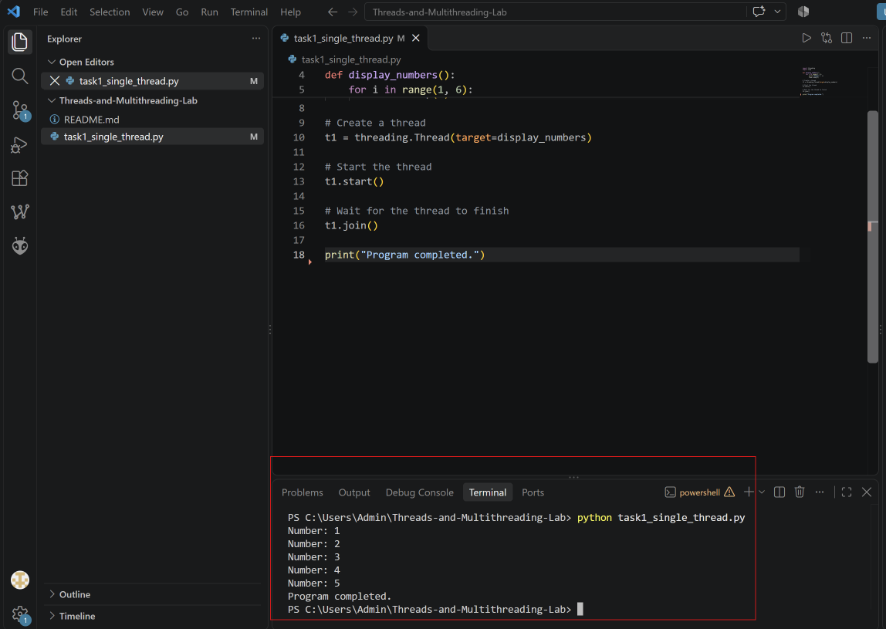
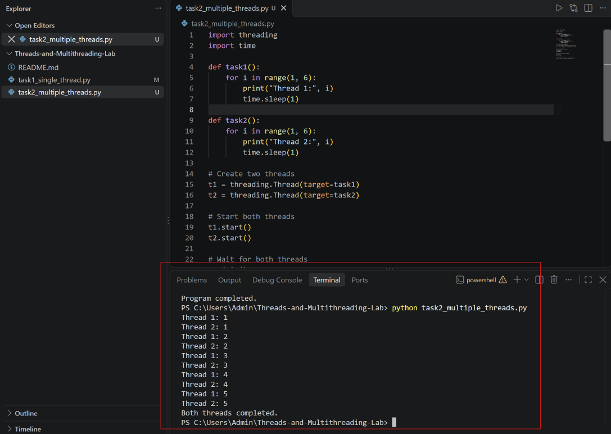
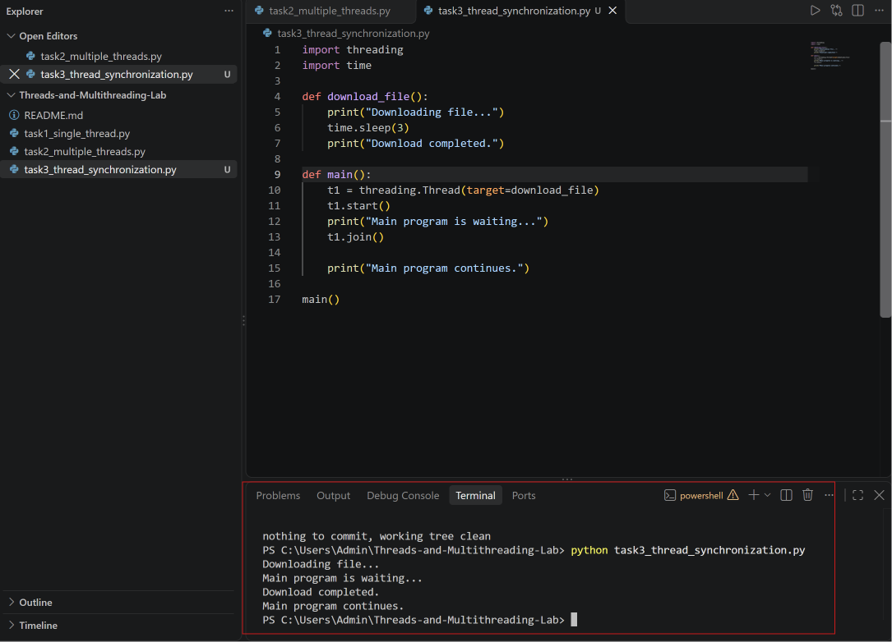
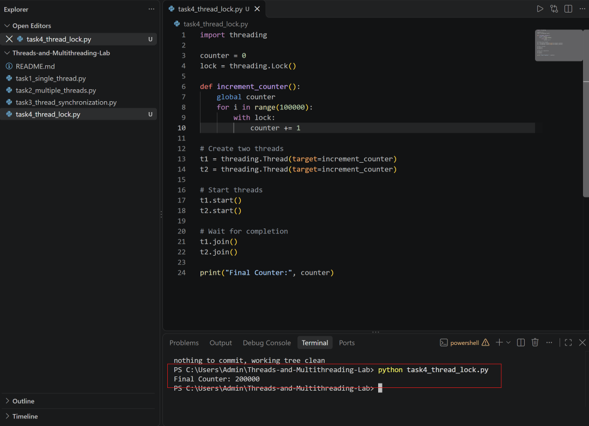

# Threads and Multithreading Laboratory

## I. Student Information

- **Name:** Ariane L. Martin
- **Section:** [BCA186.1]
- **Date:** [November 19, 2026]

## II. Laboratory Description

This laboratory demonstrates thread creation, multithreading, thread coordination, and shared-resource management using Python. It explores how multiple threads execute and how synchronization techniques help prevent problems when accessing shared data.

## III. Completed Tasks

### Task 1 – Implementing a Single Thread

A Python thread was created using the `threading.Thread()` function. The thread displayed numbers from 1 to 5 with a one-second delay between each number.

**Expected Output:**
```text
Number: 1
Number: 2
Number: 3
Number: 4
Number: 5
Program completed.
```

### Task 2 – Implementing Multiple Threads

Two threads were created and executed concurrently. Each thread displayed numbers from 1 to 5. The output order may vary because the operating system schedules thread execution.

### Task 3 – Thread Synchronization Using join()

The `join()` method was used to make the main program wait until the thread finished its execution before continuing.

When `join()` was removed, the main program could continue without waiting for the download thread to finish.

### Task 4 – Managing Shared Resources Using Thread Locks

Two threads accessed and modified a shared counter. The `threading.Lock()` function was used to protect the counter from simultaneous modifications.

The final counter reached 200000 with the lock enabled. During testing without the lock, the result also remained 200000.

## IV. Testing Observations

1. **Task 1:** The single thread successfully displayed numbers from 1 to 5.
2. **Task 2:** Both threads executed concurrently, and their output order could change.
3. **Task 3:** The `join()` method ensured that the main program waited for the thread to finish.
4. **Task 4:** The lock protected the shared counter. Even without the lock, the counter reached 200000 during the test, but race conditions could still occur.

## V. Guide Questions and Answers

### General Guide Questions

**1. What is the difference between a process and a thread?**

A process is a program that is currently running and has its own memory space. A thread is a smaller unit of execution within a process. Multiple threads in one process can share the same memory and resources.

**2. What are the advantages of multithreading?**

Multithreading allows multiple tasks to run concurrently. It improves application responsiveness and helps programs manage several activities efficiently.

**3. How does multithreading improve application responsiveness?**

It allows one task to continue while another task is waiting or performing a long operation. This prevents the entire application from becoming unresponsive.

**4. What is the difference between concurrency and parallelism?**

Concurrency means multiple tasks make progress during overlapping periods of time. Parallelism means multiple tasks execute at the exact same time, usually using multiple processor cores.

**5. Why is a lock necessary when multiple threads access shared data?**

A lock prevents multiple threads from modifying shared data at the same time. It helps avoid race conditions and protects data accuracy.

**6. What might happen if a thread is not properly synchronized?**

It may cause race conditions, incorrect results, or unexpected program behavior when multiple threads access shared resources.

**7. Can multiple threads execute simultaneously on a single-core processor? Explain.**

A single-core processor cannot execute multiple threads at the exact same instant. However, the operating system can switch between threads quickly, allowing them to make progress concurrently.

**8. How does the operating system manage kernel-level threads?**

The operating system manages kernel-level threads through its scheduler. It assigns processor time, switches between threads, and manages their execution and resources.

### Task 4 Guide Questions

**1. What is a shared resource?**

A shared resource is data or an object that can be accessed by multiple threads, such as the counter used in this activity.

**2. What is a race condition?**

A race condition happens when multiple threads access or modify shared data at the same time, potentially producing unexpected or incorrect results.

**3. What is the purpose of threading.Lock()?**

The `threading.Lock()` function creates a lock that allows only one thread at a time to access a protected section of code.

**4. What is a critical section?**

A critical section is a part of a program where shared data or resources are accessed or modified and must be protected from conflicting access.

**5. Why is synchronization important when multiple threads access shared data?**

Synchronization ensures that threads access shared data safely and in an organized way. It helps prevent data conflicts and maintains correct results.

## VI. Learning Outcomes

After completing this laboratory, the following skills and concepts were learned:

- Create and execute threads using Python.
- Demonstrate concurrent execution using multiple threads.
- Understand thread synchronization using `join()`.
- Apply locks to protect shared resources.
- Understand race conditions and the importance of synchronization.

## VII. Screenshots

### Task 1 – Single Thread


### Task 2 – Multiple Threads


### Task 3 – Thread Synchronization


### Task 4 – Thread Lock
